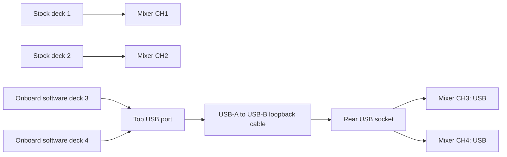

# Four simultaneous decks on the XDJ-XZ

This fork adopts the onboard four-deck implementation from upstream `beta` at
[`859ad70747174983537b21cf87a8b800b8d18274`](https://github.com/OpticMystic/XZ-Mods/tree/859ad70747174983537b21cf87a8b800b8d18274).
It adds Mac host verification and a staging command that selects the existing
four-deck view in mixer order. The target is firmware **1.26**.

The two extra players already exist in the newer upstream beta. Their source,
USB transport, control layers and display code are carried in this branch.
The fork preserves their licenses and attribution. Its additions make this
implementation reproducible and reviewable from Ronald's Mac.

## Audio and controls

| Deck | Player | Mixer channel | Physical section |
| --- | --- | --- | --- |
| 1 | Stock onboard player | CH1 | Left, native layer |
| 2 | Stock onboard player | CH2 | Right, native layer |
| 3 | Onboard software player | CH3, input set to USB | Left, software layer |
| 4 | Onboard software player | CH4, input set to USB | Right, software layer |



Press SHIFT twice on the left to switch 1/3, or on the right to switch 2/4.
The other decks keep playing. Tempo pickup holds the selected deck's tempo
until the physical fader reaches it. The saved mixer-order view is 3, 1, 2, 4.

The cable goes directly between either top USB port and the rear USB socket.
The boot/music drive goes in the opposite top port. The players run inside the
XZ; the loopback carries their sound to the mixer's existing USB inputs.
See the [full four-deck manual](manual/chapters/four-decks.md) for controls,
route states, formats and current limits.

## Prepare a local loader

Use a complete paired four-deck resource bundle from upstream. The staging
command verifies its pinned profile, runtime, receiver, helper closure and
corresponding-source archive before assembling anything. A directory containing
only `libxz-mods.so` is insufficient.

With Python 3.13 and the documented builder dependencies installed:

```sh
python tools/prepare_four_deck.py \
  --resources /absolute/path/to/paired-resources \
  --firmware /absolute/path/to/XDJXZ_v126.zip \
  --key /absolute/path/to/local/aes256.key \
  --output four-deck-build/staged
```

The output is a **local staging folder**, separate from the USB. Its `usb-root`
contains `autoexec.bin` and `VJ.Tools/XZ-Mods.cfg`. The staging receipt records
their hashes, the paired runtime and profile, image readback and selected view.
The tool uses the bundled settings serializer; other preferences retain the
runtime's defaults. `--layout number` selects 1, 2, 3, 4 instead.

Copy these two files to the root of an identified compatible USB after checking
the receipt. Preserve any existing loader and settings before an update. The
tool refuses an existing output folder and does not format drives or publish to
a Mac volume under `/Volumes`. The image contains local firmware and must stay
private. Firmware and key inputs are absent from this Git repository.

The initial prepared drive uses the **matched upstream 0.5.1-Beta ARM runtime**
also carried by the 0.5.1-Beta.1 desktop package. Its runtime SHA-256 is
`baba82b889cfd604074f8d5bf794687d447d7fde877bcfb51cba13e46ee43bd9`;
the paired quad profile is
`7483ff19664cf305a143a6b1b41580a979810e1cf5a7e3ff1dc4cd5282a80a9c`.
These are upstream binaries, with the upstream source identities retained in
the receipt. The fork's host portability changes do not constitute a new ARM
build or hardware qualification.

## Reproduce the host checks

On macOS or Linux, with Python 3.9+ and native Clang:

```sh
python tools/verify_four_deck.py --output four-deck-build/host
```

`--zig /path/to/zig` selects Zig's native C compiler instead. The command checks
real software-player code against synthetic WAV/AIFF media and a fake transport,
deck switching, held controls, tempo pickup and clocks. It also compiles an
incorrect back-cue implementation and requires its assertion to fail. It records
the compiler, input/include hashes, commands, logs and unavailable checks.
The default is UBSan; `--sanitizer address,undefined` adds ASan.

Linux also runs the route connector and fake usbfs transport suites. Mac skips
those Linux-only checks explicitly. The GitHub workflow runs both host platforms.
The host clock uses macOS's supported API; the Linux target retains its original
kernel-long clock conversion. Mac media identity uses Darwin's nanosecond stat
fields, with the existing Linux fields preserved.

Builder checks, with Python 3.13, `pycdlib==1.20.0` and `cryptography==48.0.0`:

```sh
cd source/xdj-xz-toolkit
python -m unittest builder.tests.test_firmware builder.tests.test_quad_payload builder.tests.test_current_settings -v
```

On Mac, use a canonical temporary directory whose parents are not symlinks, such
as a directory under `/private/tmp`, via `TMPDIR`. The resource verifier retains
its rejection of symlinked paths.

## Check the exported test music

Decks 3/4 resolve tracks through `PIONEER/rekordbox/export.pdb`. Copying audio
files to the drive root does not create that database. AAC/M4A files cannot play
on those decks. Import and analyse the four supported test tracks in rekordbox,
then use its USB export workflow while preserving the loader and settings.

For the first bench, use four distinct stereo 16-bit PCM WAVs at 44.1 kHz. Check
the export against those local originals before ejecting the USB:

```sh
python tools/check_four_deck_music.py \
  --volume /Volumes/XDJ-XZ \
  --expected-wavs /absolute/path/to/four-local-wavs \
  --output four-deck-build/music-check.json
```

This reads the existing Device Library PDB using the bundled parser, follows its
audio references, validates each WAV and matches the PCM hashes to the four
expected streams. It rejects missing files, truncated audio, duplicate or wrong
matches, path traversal and symlinks, and reports input changes during the check.
The report must be new and outside the USB. No drive files are written.
An export containing only M4A references cannot pass by sharing the WAV titles.

`music_ready` means that the four expected WAVs have unique matching database
entries and complete matching audio. It does not qualify beat-grid analysis,
playback, physical routing, controls, displays or hardware timing. The WAV-only
contract is for this first bench; the runtime's other supported formats remain
described in the manual. Synthetic export regression checks run on both CI hosts.

## Verified scope and hardware acceptance

The initial local Mac verification passes the player, clock, deck-selection and
96 idle-jog/deck-switch checks, plus the back-cue negative control. All 32 selected
builder/settings tests pass. The staged encrypted image passes readback of all
47 expected payload files. The dedicated USB's two installed files also match
their staging hashes. Earlier failed host builds remain recorded locally;
they are not counted as passing checks.

Host tests and file checks do not establish audible playback, physical routing,
scratch quality, clock accuracy or sustained performance on Ronald's mixer.
Upstream also has an open [four-deck BPM/scratch report](https://github.com/OpticMystic/XZ-Mods/issues/5).
This fork does not claim to fix that report.

For the first hardware check:

1. With the XZ off, insert the prepared drive in one top USB port and connect
   the loopback cable from the other top port to the rear USB socket.
2. Set CH3 and CH4 to USB. Start the XZ with decks 1/2 stopped or paused.
3. Confirm that MODS opens and that the route reports **DECKS 3 AND 4 ARE READY**.
   Music is optional for this startup check.
4. Export test music from rekordbox to the boot/music drive, retaining its loader
   and settings. For the first audio check use WAV or AIFF; AAC/M4A is unsupported
   on decks 3/4. Start with low monitor levels.
5. Load four distinct tracks. Verify that each channel fader and headphone cue
   affects its assigned deck, and that switching 1/3 and 2/4 leaves other tracks
   running. Check the displayed deck identity on both control layers.
6. Stop playback. To return to stock, follow the upstream procedure: power off,
   remove the mod USB, then restart normally. Record the actual result.

Record startup, master/booth/headphone routing, control/display identity,
reconnect, and return to stock separately. The project's sustained-playback and
cold-start criteria remain open until observed. No firmware update is part of
this USB preparation.
