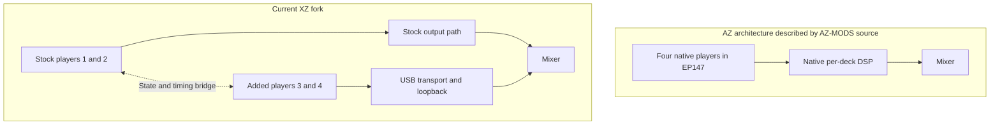

# Make four-deck operation consistent on the XDJ-XZ

Research checkpoint: 2026-11-04. Baseline:
`5b7dad7630bf14075efe9581c57ec1b61ab2de25` (`four-deck-hardware`).
Ronald confirms that four tracks play together through separate mixer channels
on his XDJ-XZ. This is direct user-reported hardware evidence for the core
four-deck result. Detailed control, timing, endurance and stock-return results
remain unmeasured here. This branch has not changed the player runtime or the
boot USB.

## What the AZ comparison establishes

The [official AZ product description](https://alphatheta.com/en/product/all-in-one-dj-system/xdj-az/black/)
documents standalone four-deck playback. The manufacturer's
[1.30 announcement](https://alphatheta.com/en/information/update-xdj-az-firmware-ver-1-30/)
dates the enlarged four-deck waveform view to April 9, 2026. Playback architecture
and waveform presentation are therefore separate reference questions.

Two official reference downloads were inspected locally:

| Input | Verified identity | What was inspected |
| --- | --- | --- |
| [AZ 2.00 firmware ZIP](https://downloads.support.alphatheta.com/firmwares/all-in-one-dj-systems/XDJ-AZ/XDJAZv200.zip) | 182,387,522 bytes; SHA-256 `f56b84c034fec86f319451153ac24e0b7f1ba32cdf5c7366e9f7a75d57e07f6f` | ZIP member and CRC; LUKS1 header of `XDJAZv200.UPD` |
| [AZ 2.00 published source/BSP](https://www.pioneerdj.com/product-large-files/v_200/XDJ-AZ.tar.gz) | 1,436,886,444 bytes; SHA-256 `49a4c60648de5374848b9c2d379b3a847be1a73b92256d3007e90ae0af9abe8f` | Selected board/build configuration, after matching the manufacturer's MD5 |

The [manufacturer's source index](https://www.pioneerdj.com/en/support/open-source-code-distribution/gnu-open-source-license/)
lists AZ 2.00. Its linked readme publishes the BSP MD5
`143d9eacf4b5830c1d00b76d0d878e75`, which the downloaded file matches.

The UPD SHA-256 is
`ac799829427ee0483cc8ba219684cb341b7ecf1efd0a771390508fefae077ef8`.
Its header declares LUKS version 1, AES, `xts-plain64`, SHA-256 and a
2,097,152-byte payload offset. It was not decrypted. No AZ application binary,
stock DSP algorithm, runtime performance or installed AZ behavior was recovered
or measured from that update.

The BSP's `device/rockchip/rk3399/BoardConfig.mk` selects `RK_ARCH=arm64`,
`RK_TARGET_PRODUCT=rk3399`, `rockchip_atc_linux_defconfig` and
`rk3399-atc-board-V03`. In contrast, this XZ mod's `mods/build.py` targets
`arm-linux-gnueabi.2.13`, Cortex-A9 and the ARM32 soft-float ABI. These facts rule
out treating AZ binaries as drop-in XZ replacements. They do not quantify the
XZ's spare CPU/RAM or establish an internal four-channel XZ output route.

## Useful source reference

AZ-MODS was inspected at
[`de548c7785671d06b9c8f21df56c7b379e861ffc`](https://github.com/Kyle-Hosman/xdj-az-mods/tree/de548c7785671d06b9c8f21df56c7b379e861ffc).
This is community modification source, not the manufacturer's application source.
Its source and architecture notes describe an AArch64 `EP147` process with four
`DjPlayerUnit` instances. Its hooks identify decks from constructor arguments,
capture track state inside native updates, and inject PCM before the native
tempo/key/scratch processing. The modification's audio hooks defer decoding,
file access and logging to other threads. Those are design references; none of
the AZ hook addresses or object offsets are valid XZ patch inputs.

Relevant pinned files:

- [Architecture](https://github.com/Kyle-Hosman/xdj-az-mods/blob/de548c7785671d06b9c8f21df56c7b379e861ffc/ARCHITECTURE.md)
- [Deck identity and track mapping](https://github.com/Kyle-Hosman/xdj-az-mods/blob/de548c7785671d06b9c8f21df56c7b379e861ffc/src/azstem/deck_track_map.c)
- [Native source-read and DSP hooks](https://github.com/Kyle-Hosman/xdj-az-mods/blob/de548c7785671d06b9c8f21df56c7b379e861ffc/src/azstem/key_shift.c)
- [Engine-rate evidence](https://github.com/Kyle-Hosman/xdj-az-mods/blob/de548c7785671d06b9c8f21df56c7b379e861ffc/src/azstem/ep147rate.h)

The rate header distinguishes the documented 44.1 kHz deck timeline from the
96 kHz audio-device rate. Do not assume that raising the XZ software rate to
96 kHz will improve sync; the reference itself separates these clock domains.
No AZ-MODS implementation has been copied into the XZ runtime.



## Improvements in order

### 1. Measure and correct timing across the two XZ paths

An [open upstream report](https://github.com/OpticMystic/XZ-Mods/issues/5)
describes BPM drift, short backspins and different jog sensitivity on decks 3/4.
It does not establish that Ronald's unit has those faults or identify their cause.

Start from `mods/extra_player.c`, `sync_native.c`, `sync_link_runtime.c` and
`audio/usb_transport/`. The existing implementation already tracks transport
generations, source/wire-frame tags and estimated wire-clock origins. Its
transport contract explicitly distinguishes USB completion from measured
audible presentation. Preserve those distinctions.

Use the same analysed click track first on a native deck and a software deck.
Measure a constant offset separately from offset growth over time. A constant
delay needs different treatment from sample-clock drift, an incorrect beat grid
or a BPM interpretation error. Then exercise master handover, pause, seek,
hot cues and jog release. Compare recorded audio against the on-screen phase;
an aligned display is not proof of aligned audio.

Acceptance: stated measurement duration and sample rate; per-deck initial offset,
drift, discontinuities and underruns; deliberate tests of master handover and
transport changes. Choose correction parameters from those observations. Do not
reduce USB queue depth or change clock formulas on the strength of the AZ design
alone. This checkpoint does not set an unsupported numerical performance promise.

### 2. Make physical control ownership and tempo pickup visible

`deck_select.c` already retains per-side ownership, held-key release routing,
selection epochs and tempo pickup. `shell/shell.h` publishes `sides_extra` to
the interface. Extend the existing model with a coherent, read-only pickup
status, then show which physical side controls each deck and why a fader is
waiting. Preserve each deck's tempo during a switch and preserve the owner of a
held cue, pad or jog until its release. Do not replace double-SHIFT or add a new
gesture until the user has assessed that control choice.

Acceptance: switching 1/3 and 2/4 during playback does not change the other deck;
pickup feedback matches the actual gate; held controls release to their original
owner; route loss invalidates stale indications. Update the manual and inspect
its renderer proofs in the same runtime/UI change, as required by AGENTS.md.

### 3. Match cue, jog and track-loading behavior

Measure the added players against stock decks using the same track, pad mode,
vinyl setting and tempo. Prioritize cue response, backspin travel, pitch bend,
loop exit and quantize boundaries. Decoder prefetch and buffer retention must
fit measured XZ memory and scheduling limits. AAC/M4A currently remain unsupported
on 3/4; a future decoder needs build/license/resource checks as well as audio
testing. Retain independent loading so a new track cannot interrupt another deck.

### 4. Qualify four-deck operation as a set

Run four simultaneous distinct tracks; verify channel isolation, master/booth
and headphone cue, controls on both layers, loading during playback, reconnect,
at least 30 minutes of continuous use, three cold boots and return to stock.
Capture defects and runtime identity with each result. Preserve the working USB
as the rollback baseline while preparing a separate candidate.

Removing the loopback cable is a separate routing investigation. The inspected
AZ configuration does not show how to expose additional internal XZ audio outputs.

## Reproduce the reference intake

Download the two official files above to local storage. From the repository root:

```sh
python3 tools/inspect_az_reference.py \
  --firmware-zip /path/to/XDJAZv200.zip \
  --bsp /path/to/XDJ-AZ.tar.gz \
  --output /path/to/new-intake.json
```

The tool checks the pinned ZIP/UPD hashes, reads the ZIP member through its CRC,
checks the BSP against the published MD5, and records four selected configuration
members. It reads inputs, refuses an existing report and never extracts scripts
to execute, decrypts firmware, accesses a device or prepares a boot image.

The original local `forks/XZ-Mods` checkout was found with zero-byte Git metadata
and many zero-byte source files on 2026-11-04. It was left untouched. Development
continues from a separate GitHub clone, `forks/XZ-Mods-seamless`, with the baseline
commit and Git object integrity rechecked. No cause for the local damage is known.

Validation at this checkpoint: the recovered baseline passes all ten Mac host
checks (clock, deck selection, idle-jog switching, actual player/fake transport,
builds and rejected back-cue mutation). The intake command succeeds against the
real downloaded files; altered firmware/BSP inputs are refused. These checks
validate the reference intake and recovered source, not new mixer performance.
